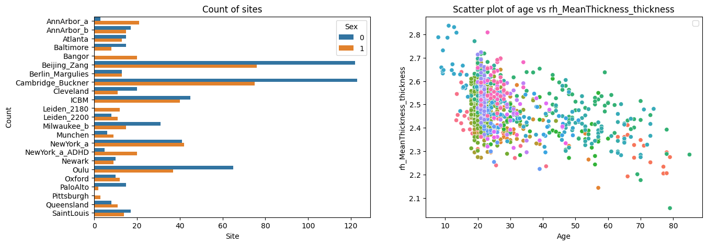

Command line interface
======================

.. container:: notebook-download

   :download:`Download Jupyter notebook <notebooks/09_command_line_interface.ipynb>`

The PCNtoolkit is a python package, but it can also be used from the
command line.

Here we show how to use the PCNtoolkit from the command line.

Furthermore, you can use this script to generate commands for the
command line interface. (Although if you are able to run this notebook,
why not just use it as a python package?)

.. code:: ipython3

    import os
    import pickle
    import sys
    
    import matplotlib.pyplot as plt
    import pandas as pd
    import seaborn as sns
    from sklearn.model_selection import train_test_split

BLR Example
-----------

Data preparation
~~~~~~~~~~~~~~~~

.. code:: ipython3

    # Download and split data first
    # If you are running this notebook for the first time, you need to download the dataset from github.
    # If you have already downloaded the dataset, you can comment out the following line
    os.makedirs("resources/data", exist_ok=True)
    pd.read_csv(
        "https://raw.githubusercontent.com/predictive-clinical-neuroscience/PCNtoolkit-demo/refs/heads/main/data/fcon1000.csv"
    ).to_csv("resources/data/fcon1000.csv", index=False)

.. code:: ipython3

    data = pd.read_csv("resources/data/fcon1000.csv")

.. code:: ipython3

    # Inspect the data
    fig, ax = plt.subplots(1, 2, figsize=(15, 5))
    sns.scatterplot(
        data=data, x=("age"), y=("rh_MeanThickness_thickness"), hue=("site"), ax=ax[1]
    )
    ax[1].legend([], [])
    ax[1].set_title("Scatter plot of age vs rh_MeanThickness_thickness")
    ax[1].set_xlabel("Age")
    ax[1].set_ylabel("rh_MeanThickness_thickness")
    sns.countplot(data=data, y="site", hue="sex", ax=ax[0], orient="h")
    ax[0].legend(title="Sex")
    ax[0].set_title("Count of sites")
    ax[0].set_xlabel("Site")
    ax[0].set_ylabel("Count")
    plt.show()

.. code:: ipython3

    # Split into X, y, and batch effects
    covariate_columns = ["age"]
    batch_effect_columns = ["sex", "site"]
    response_columns = ["rh_MeanThickness_thickness", "WM-hypointensities"]
    
    X = data[covariate_columns]
    Y = data[response_columns]
    batch_effects = data[batch_effect_columns]
    
    batch_effects_strings = [str(b[0]) + " " + str(b[1]) for b in batch_effects.values]
    
    # Split into train and test set
    trainidx, testidx = train_test_split(
        data.index, test_size=0.2, random_state=42, stratify=batch_effects_strings
    )
    train_X = X.loc[trainidx]
    train_Y = Y.loc[trainidx]
    train_batch_effects = batch_effects.loc[trainidx]
    
    test_X = X.loc[testidx]
    test_Y = Y.loc[testidx]
    test_batch_effects = batch_effects.loc[testidx]

.. code:: ipython3

    # Save stuff
    root_dir = os.path.join("resources", "cli_example")
    data_dir = os.path.join(root_dir, "data")
    os.makedirs(data_dir, exist_ok=True)
    
    resp = os.path.abspath(os.path.join(data_dir, "responses.csv"))
    cov = os.path.abspath(os.path.join(data_dir, "covariates.csv"))
    be = os.path.abspath(os.path.join(data_dir, "batch_effects.csv"))
    
    t_resp = os.path.abspath(os.path.join(data_dir, "test_responses.csv"))
    t_cov = os.path.abspath(os.path.join(data_dir, "test_covariates.csv"))
    t_be = os.path.abspath(os.path.join(data_dir, "test_batch_effects.csv"))
    
    
    with open(cov, "wb") as f:
        pickle.dump(train_X, f)
    with open(resp, "wb") as f:
        pickle.dump(train_Y, f)
    with open(be, "wb") as f:
        pickle.dump(train_batch_effects, f)
    with open(t_cov, "wb") as f:
        pickle.dump(test_X, f)
    with open(t_resp, "wb") as f:
        pickle.dump(test_Y, f)
    with open(t_be, "wb") as f:
        pickle.dump(test_batch_effects, f)

BLR configuration
~~~~~~~~~~~~~~~~~

.. code:: ipython3

    alg = "blr"
    func = "fit_predict"
    
    # normative model configuration
    save_dir = os.path.join(root_dir, "blr_cli", "save_dir")
    savemodel = True
    saveresults = True
    basis_function = "linear"
    inscaler = "standardize"
    outscaler = "standardize"
    
    # Regression model configuration
    optimizer = "l-bfgs-b"
    n_iter = 200
    heteroskedastic = True
    fixed_effect = True
    warp = "WarpSinhArcsinh"
    warp_reparam = True
    
    # runner configuration
    cross_validate = True
    cv_folds = 5
    parallelize = False
    job_type = "local"
    n_jobs = 2
    temp_dir = os.path.join(root_dir, "temp")
    log_dir = os.path.join(root_dir, "log")
    python_env = os.path.join(os.path.dirname(os.path.dirname(sys.executable)))

Constructing command
~~~~~~~~~~~~~~~~~~~~

.. code:: ipython3

    command = "normative"
    args = f"-a {alg} -f {func} -c {cov} -r {resp} -t {t_resp} -e {t_cov} -k {cv_folds}"
    kwargs = f"be={be} t_be={t_be}"
    normative_model_kwargs = f"save_dir={save_dir} savemodel={savemodel} saveresults={saveresults} basis_function={basis_function} inscaler={inscaler} outscaler={outscaler}"
    runner_kwargs = f"cross_validate={cross_validate} parallelize={parallelize} job_type={job_type} n_jobs={n_jobs} temp_dir={temp_dir} log_dir={log_dir} environment={python_env}"
    blr_kwargs = f"optimizer={optimizer} n_iter={n_iter} heteroskedastic={heteroskedastic} fixed_effect={fixed_effect} warp={warp} warp_reparam={warp_reparam}"
    full_command = (
        f"{command} {args} {kwargs} {runner_kwargs} {normative_model_kwargs} {blr_kwargs}"
    )

.. code:: ipython3

    print(full_command)

.. code:: text

    normative -a blr -f fit_predict -c c:\Users\kontsi\Documents\GitHub\PCNtoolkit-local\examples\resources\cli_example\data\covariates.csv -r c:\Users\kontsi\Documents\GitHub\PCNtoolkit-local\examples\resources\cli_example\data\responses.csv -t c:\Users\kontsi\Documents\GitHub\PCNtoolkit-local\examples\resources\cli_example\data\test_responses.csv -e c:\Users\kontsi\Documents\GitHub\PCNtoolkit-local\examples\resources\cli_example\data\test_covariates.csv -k 5 be=c:\Users\kontsi\Documents\GitHub\PCNtoolkit-local\examples\resources\cli_example\data\batch_effects.csv t_be=c:\Users\kontsi\Documents\GitHub\PCNtoolkit-local\examples\resources\cli_example\data\test_batch_effects.csv cross_validate=True parallelize=False job_type=local n_jobs=2 temp_dir=resources\cli_example\temp log_dir=resources\cli_example\log environment=c:\Users\kontsi\AppData\Local\anaconda3\envs save_dir=resources\cli_example\blr_cli\save_dir savemodel=True saveresults=True basis_function=linear inscaler=standardize outscaler=standardize optimizer=l-bfgs-b n_iter=200 heteroskedastic=True fixed_effect=True warp=WarpSinhArcsinh warp_reparam=True
    

Running command
~~~~~~~~~~~~~~~

.. code:: ipython3

    !{full_command}

.. code:: text

    Process: 34708 - 2026-10-15 16:52:12 - Dataset "fit_data" created.
        - 862 observations
        - 862 unique subjects
        - 1 covariates
        - 2 response variables
        - 2 batch effects:
        	batch_effect_0 (2)
    	batch_effect_1 (23)
        
    Process: 34708 - 2026-10-15 16:52:12 - Dataset "predict_data" created.
        - 216 observations
        - 216 unique subjects
        - 1 covariates
        - 2 response variables
        - 2 batch effects:
        	batch_effect_0 (2)
    	batch_effect_1 (23)
        
    Process: 34708 - 2026-10-15 16:52:12 - Task ID created: fit_predict_fit_data__2026-10-15_16-52-12_71.303223
    Process: 34708 - 2026-10-15 16:52:12 - Temporary directory created:
    	c:\Users\kontsi\Documents\GitHub\PCNtoolkit-local\examples\resources\cli_example\temp\fit_predict_fit_data__2026-10-15_16-52-12_71.303223
    Process: 34708 - 2026-10-15 16:52:12 - Log directory created:
    	c:\Users\kontsi\Documents\GitHub\PCNtoolkit-local\examples\resources\cli_example\log\fit_predict_fit_data__2026-10-15_16-52-12_71.303223
    Process: 34708 - 2026-10-15 16:52:12 - Fitting models on 2 response variables.
    Process: 34708 - 2026-10-15 16:52:12 - Fitting model for response_var_0.
    Process: 34708 - 2026-10-15 16:52:12 - Fitting model for response_var_1.
    Process: 34708 - 2026-10-15 16:52:12 - Saving model to:
    	resources\cli_example\blr_cli\save_dir\folds\fold_0.
    Process: 34708 - 2026-10-15 16:52:12 - Making predictions on 2 response variables.
    Process: 34708 - 2026-10-15 16:52:12 - Computing z-scores for 2 response variables.
    Process: 34708 - 2026-10-15 16:52:12 - Computing z-scores for response_var_1.
    Process: 34708 - 2026-10-15 16:52:12 - Computing z-scores for response_var_0.
    Process: 34708 - 2026-10-15 16:52:12 - Computing centiles for 2 response variables.
    Process: 34708 - 2026-10-15 16:52:12 - Computing centiles for response_var_1.
    Process: 34708 - 2026-10-15 16:52:12 - Computing centiles for response_var_0.
    Process: 34708 - 2026-10-15 16:52:12 - Computing log-probabilities for 2 response variables.
    Process: 34708 - 2026-10-15 16:52:12 - Computing log-probabilities for 2 response variables.
    Process: 34708 - 2026-10-15 16:52:12 - Computing log-probabilities for response_var_1.
    Process: 34708 - 2026-10-15 16:52:12 - Computing log-probabilities for response_var_0.
    Process: 34708 - 2026-10-15 16:52:12 - Computing yhat for 2 response variables.
    Process: 34708 - 2026-10-15 16:52:12 - Computing yhat for response_var_1.
    Process: 34708 - 2026-10-15 16:52:12 - Computing yhat for response_var_0.
    Process: 34708 - 2026-10-15 16:52:13 - Dataset "centile" created.
        - 150 observations
        - 150 unique subjects
        - 1 covariates
        - 2 response variables
        - 2 batch effects:
        	batch_effect_0 (1)
    	batch_effect_1 (1)
        
    Process: 34708 - 2026-10-15 16:52:13 - Computing centiles for 2 response variables.
    Process: 34708 - 2026-10-15 16:52:13 - Computing centiles for response_var_1.
    Process: 34708 - 2026-10-15 16:52:13 - Computing centiles for response_var_0.
    Process: 34708 - 2026-10-15 16:52:13 - Harmonizing data on 2 response variables.
    Process: 34708 - 2026-10-15 16:52:13 - Harmonizing data for response_var_1.
    Process: 34708 - 2026-10-15 16:52:13 - Harmonizing data for response_var_0.
    Process: 34708 - 2026-10-15 16:52:13 - Making predictions on 2 response variables.
    Process: 34708 - 2026-10-15 16:52:13 - Computing z-scores for 2 response variables.
    Process: 34708 - 2026-10-15 16:52:13 - Computing z-scores for response_var_1.
    Process: 34708 - 2026-10-15 16:52:13 - Computing z-scores for response_var_0.
    Process: 34708 - 2026-10-15 16:52:13 - Computing centiles for 2 response variables.
    Process: 34708 - 2026-10-15 16:52:13 - Computing centiles for response_var_1.
    Process: 34708 - 2026-10-15 16:52:13 - Computing centiles for response_var_0.
    Process: 34708 - 2026-10-15 16:52:13 - Computing log-probabilities for 2 response variables.
    Process: 34708 - 2026-10-15 16:52:13 - Computing log-probabilities for 2 response variables.
    Process: 34708 - 2026-10-15 16:52:13 - Computing log-probabilities for response_var_1.
    Process: 34708 - 2026-10-15 16:52:13 - Computing log-probabilities for response_var_0.
    Process: 34708 - 2026-10-15 16:52:13 - Computing yhat for 2 response variables.
    Process: 34708 - 2026-10-15 16:52:13 - Computing yhat for response_var_1.
    Process: 34708 - 2026-10-15 16:52:14 - Computing yhat for response_var_0.
    Process: 34708 - 2026-10-15 16:52:14 - Dataset "centile" created.
        - 150 observations
        - 150 unique subjects
        - 1 covariates
        - 2 response variables
        - 2 batch effects:
        	batch_effect_0 (1)
    	batch_effect_1 (1)
        
    Process: 34708 - 2026-10-15 16:52:14 - Computing centiles for 2 response variables.
    Process: 34708 - 2026-10-15 16:52:14 - Computing centiles for response_var_1.
    Process: 34708 - 2026-10-15 16:52:14 - Computing centiles for response_var_0.
    Process: 34708 - 2026-10-15 16:52:14 - Harmonizing data on 2 response variables.
    Process: 34708 - 2026-10-15 16:52:14 - Harmonizing data for response_var_1.
    Process: 34708 - 2026-10-15 16:52:14 - Harmonizing data for response_var_0.
    Process: 34708 - 2026-10-15 16:52:15 - Fitting models on 2 response variables.
    Process: 34708 - 2026-10-15 16:52:15 - Fitting model for response_var_0.
    Process: 34708 - 2026-10-15 16:52:15 - Fitting model for response_var_1.
    Process: 34708 - 2026-10-15 16:52:15 - Saving model to:
    	resources\cli_example\blr_cli\save_dir\folds\fold_1.
    Process: 34708 - 2026-10-15 16:52:15 - Making predictions on 2 response variables.
    Process: 34708 - 2026-10-15 16:52:15 - Computing z-scores for 2 response variables.
    Process: 34708 - 2026-10-15 16:52:15 - Computing z-scores for response_var_1.
    Process: 34708 - 2026-10-15 16:52:15 - Computing z-scores for response_var_0.
    Process: 34708 - 2026-10-15 16:52:15 - Computing centiles for 2 response variables.
    Process: 34708 - 2026-10-15 16:52:15 - Computing centiles for response_var_1.
    Process: 34708 - 2026-10-15 16:52:15 - Computing centiles for response_var_0.
    Process: 34708 - 2026-10-15 16:52:15 - Computing log-probabilities for 2 response variables.
    Process: 34708 - 2026-10-15 16:52:15 - Computing log-probabilities for 2 response variables.
    Process: 34708 - 2026-10-15 16:52:15 - Computing log-probabilities for response_var_1.
    Process: 34708 - 2026-10-15 16:52:15 - Computing log-probabilities for response_var_0.
    Process: 34708 - 2026-10-15 16:52:15 - Computing yhat for 2 response variables.
    Process: 34708 - 2026-10-15 16:52:15 - Computing yhat for response_var_1.
    Process: 34708 - 2026-10-15 16:52:15 - Computing yhat for response_var_0.
    Process: 34708 - 2026-10-15 16:52:16 - Dataset "centile" created.
        - 150 observations
        - 150 unique subjects
        - 1 covariates
        - 2 response variables
        - 2 batch effects:
        	batch_effect_0 (1)
    	batch_effect_1 (1)
        
    Process: 34708 - 2026-10-15 16:52:16 - Computing centiles for 2 response variables.
    Process: 34708 - 2026-10-15 16:52:16 - Computing centiles for response_var_1.
    Process: 34708 - 2026-10-15 16:52:16 - Computing centiles for response_var_0.
    Process: 34708 - 2026-10-15 16:52:16 - Harmonizing data on 2 response variables.
    Process: 34708 - 2026-10-15 16:52:16 - Harmonizing data for response_var_1.
    Process: 34708 - 2026-10-15 16:52:16 - Harmonizing data for response_var_0.
    Process: 34708 - 2026-10-15 16:52:16 - Making predictions on 2 response variables.
    Process: 34708 - 2026-10-15 16:52:16 - Computing z-scores for 2 response variables.
    Process: 34708 - 2026-10-15 16:52:16 - Computing z-scores for response_var_1.
    Process: 34708 - 2026-10-15 16:52:16 - Computing z-scores for response_var_0.
    Process: 34708 - 2026-10-15 16:52:16 - Computing centiles for 2 response variables.
    Process: 34708 - 2026-10-15 16:52:16 - Computing centiles for response_var_1.
    Process: 34708 - 2026-10-15 16:52:16 - Computing centiles for response_var_0.
    Process: 34708 - 2026-10-15 16:52:16 - Computing log-probabilities for 2 response variables.
    Process: 34708 - 2026-10-15 16:52:16 - Computing log-probabilities for 2 response variables.
    Process: 34708 - 2026-10-15 16:52:16 - Computing log-probabilities for response_var_1.
    Process: 34708 - 2026-10-15 16:52:16 - Computing log-probabilities for response_var_0.
    Process: 34708 - 2026-10-15 16:52:16 - Computing yhat for 2 response variables.
    Process: 34708 - 2026-10-15 16:52:16 - Computing yhat for response_var_1.
    Process: 34708 - 2026-10-15 16:52:16 - Computing yhat for response_var_0.
    Process: 34708 - 2026-10-15 16:52:17 - Dataset "centile" created.
        - 150 observations
        - 150 unique subjects
        - 1 covariates
        - 2 response variables
        - 2 batch effects:
        	batch_effect_0 (1)
    	batch_effect_1 (1)
        
    Process: 34708 - 2026-10-15 16:52:17 - Computing centiles for 2 response variables.
    Process: 34708 - 2026-10-15 16:52:17 - Computing centiles for response_var_1.
    Process: 34708 - 2026-10-15 16:52:17 - Computing centiles for response_var_0.
    Process: 34708 - 2026-10-15 16:52:17 - Harmonizing data on 2 response variables.
    Process: 34708 - 2026-10-15 16:52:17 - Harmonizing data for response_var_1.
    Process: 34708 - 2026-10-15 16:52:17 - Harmonizing data for response_var_0.
    Process: 34708 - 2026-10-15 16:52:18 - Fitting models on 2 response variables.
    Process: 34708 - 2026-10-15 16:52:18 - Fitting model for response_var_0.
    Process: 34708 - 2026-10-15 16:52:18 - Fitting model for response_var_1.
    Process: 34708 - 2026-10-15 16:52:18 - Saving model to:
    	resources\cli_example\blr_cli\save_dir\folds\fold_2.
    Process: 34708 - 2026-10-15 16:52:18 - Making predictions on 2 response variables.
    Process: 34708 - 2026-10-15 16:52:18 - Computing z-scores for 2 response variables.
    Process: 34708 - 2026-10-15 16:52:18 - Computing z-scores for response_var_1.
    Process: 34708 - 2026-10-15 16:52:18 - Computing z-scores for response_var_0.
    Process: 34708 - 2026-10-15 16:52:18 - Computing centiles for 2 response variables.
    Process: 34708 - 2026-10-15 16:52:18 - Computing centiles for response_var_1.
    Process: 34708 - 2026-10-15 16:52:18 - Computing centiles for response_var_0.
    Process: 34708 - 2026-10-15 16:52:18 - Computing log-probabilities for 2 response variables.
    Process: 34708 - 2026-10-15 16:52:18 - Computing log-probabilities for 2 response variables.
    Process: 34708 - 2026-10-15 16:52:18 - Computing log-probabilities for response_var_1.
    Process: 34708 - 2026-10-15 16:52:18 - Computing log-probabilities for response_var_0.
    Process: 34708 - 2026-10-15 16:52:18 - Computing yhat for 2 response variables.
    Process: 34708 - 2026-10-15 16:52:18 - Computing yhat for response_var_1.
    Process: 34708 - 2026-10-15 16:52:18 - Computing yhat for response_var_0.
    Process: 34708 - 2026-10-15 16:52:19 - Dataset "centile" created.
        - 150 observations
        - 150 unique subjects
        - 1 covariates
        - 2 response variables
        - 2 batch effects:
        	batch_effect_0 (1)
    	batch_effect_1 (1)
        
    Process: 34708 - 2026-10-15 16:52:19 - Computing centiles for 2 response variables.
    Process: 34708 - 2026-10-15 16:52:19 - Computing centiles for response_var_1.
    Process: 34708 - 2026-10-15 16:52:19 - Computing centiles for response_var_0.
    Process: 34708 - 2026-10-15 16:52:19 - Harmonizing data on 2 response variables.
    Process: 34708 - 2026-10-15 16:52:19 - Harmonizing data for response_var_1.
    Process: 34708 - 2026-10-15 16:52:19 - Harmonizing data for response_var_0.
    Process: 34708 - 2026-10-15 16:52:19 - Making predictions on 2 response variables.
    Process: 34708 - 2026-10-15 16:52:19 - Computing z-scores for 2 response variables.
    Process: 34708 - 2026-10-15 16:52:19 - Computing z-scores for response_var_1.
    Process: 34708 - 2026-10-15 16:52:19 - Computing z-scores for response_var_0.
    Process: 34708 - 2026-10-15 16:52:19 - Computing centiles for 2 response variables.
    Process: 34708 - 2026-10-15 16:52:19 - Computing centiles for response_var_1.
    Process: 34708 - 2026-10-15 16:52:19 - Computing centiles for response_var_0.
    Process: 34708 - 2026-10-15 16:52:19 - Computing log-probabilities for 2 response variables.
    Process: 34708 - 2026-10-15 16:52:19 - Computing log-probabilities for 2 response variables.
    Process: 34708 - 2026-10-15 16:52:19 - Computing log-probabilities for response_var_1.
    Process: 34708 - 2026-10-15 16:52:19 - Computing log-probabilities for response_var_0.
    Process: 34708 - 2026-10-15 16:52:19 - Computing yhat for 2 response variables.
    Process: 34708 - 2026-10-15 16:52:19 - Computing yhat for response_var_1.
    Process: 34708 - 2026-10-15 16:52:19 - Computing yhat for response_var_0.
    Process: 34708 - 2026-10-15 16:52:20 - Dataset "centile" created.
        - 150 observations
        - 150 unique subjects
        - 1 covariates
        - 2 response variables
        - 2 batch effects:
        	batch_effect_0 (1)
    	batch_effect_1 (1)
        
    Process: 34708 - 2026-10-15 16:52:20 - Computing centiles for 2 response variables.
    Process: 34708 - 2026-10-15 16:52:20 - Computing centiles for response_var_1.
    Process: 34708 - 2026-10-15 16:52:20 - Computing centiles for response_var_0.
    Process: 34708 - 2026-10-15 16:52:20 - Harmonizing data on 2 response variables.
    Process: 34708 - 2026-10-15 16:52:20 - Harmonizing data for response_var_1.
    Process: 34708 - 2026-10-15 16:52:20 - Harmonizing data for response_var_0.
    Process: 34708 - 2026-10-15 16:52:20 - Fitting models on 2 response variables.
    Process: 34708 - 2026-10-15 16:52:20 - Fitting model for response_var_0.
    Process: 34708 - 2026-10-15 16:52:20 - Fitting model for response_var_1.
    Process: 34708 - 2026-10-15 16:52:21 - Saving model to:
    	resources\cli_example\blr_cli\save_dir\folds\fold_3.
    Process: 34708 - 2026-10-15 16:52:21 - Making predictions on 2 response variables.
    Process: 34708 - 2026-10-15 16:52:21 - Computing z-scores for 2 response variables.
    Process: 34708 - 2026-10-15 16:52:21 - Computing z-scores for response_var_1.
    Process: 34708 - 2026-10-15 16:52:21 - Computing z-scores for response_var_0.
    Process: 34708 - 2026-10-15 16:52:21 - Computing centiles for 2 response variables.
    Process: 34708 - 2026-10-15 16:52:21 - Computing centiles for response_var_1.
    Process: 34708 - 2026-10-15 16:52:21 - Computing centiles for response_var_0.
    Process: 34708 - 2026-10-15 16:52:21 - Computing log-probabilities for 2 response variables.
    Process: 34708 - 2026-10-15 16:52:21 - Computing log-probabilities for 2 response variables.
    Process: 34708 - 2026-10-15 16:52:21 - Computing log-probabilities for response_var_1.
    Process: 34708 - 2026-10-15 16:52:21 - Computing log-probabilities for response_var_0.
    Process: 34708 - 2026-10-15 16:52:21 - Computing yhat for 2 response variables.
    Process: 34708 - 2026-10-15 16:52:21 - Computing yhat for response_var_1.
    Process: 34708 - 2026-10-15 16:52:21 - Computing yhat for response_var_0.
    Process: 34708 - 2026-10-15 16:52:21 - Dataset "centile" created.
        - 150 observations
        - 150 unique subjects
        - 1 covariates
        - 2 response variables
        - 2 batch effects:
        	batch_effect_0 (1)
    	batch_effect_1 (1)
        
    Process: 34708 - 2026-10-15 16:52:21 - Computing centiles for 2 response variables.
    Process: 34708 - 2026-10-15 16:52:21 - Computing centiles for response_var_1.
    Process: 34708 - 2026-10-15 16:52:21 - Computing centiles for response_var_0.
    Process: 34708 - 2026-10-15 16:52:21 - Harmonizing data on 2 response variables.
    Process: 34708 - 2026-10-15 16:52:21 - Harmonizing data for response_var_1.
    Process: 34708 - 2026-10-15 16:52:21 - Harmonizing data for response_var_0.
    Process: 34708 - 2026-10-15 16:52:22 - Making predictions on 2 response variables.
    Process: 34708 - 2026-10-15 16:52:22 - Computing z-scores for 2 response variables.
    Process: 34708 - 2026-10-15 16:52:22 - Computing z-scores for response_var_1.
    Process: 34708 - 2026-10-15 16:52:22 - Computing z-scores for response_var_0.
    Process: 34708 - 2026-10-15 16:52:22 - Computing centiles for 2 response variables.
    Process: 34708 - 2026-10-15 16:52:22 - Computing centiles for response_var_1.
    Process: 34708 - 2026-10-15 16:52:22 - Computing centiles for response_var_0.
    Process: 34708 - 2026-10-15 16:52:22 - Computing log-probabilities for 2 response variables.
    Process: 34708 - 2026-10-15 16:52:22 - Computing log-probabilities for 2 response variables.
    Process: 34708 - 2026-10-15 16:52:22 - Computing log-probabilities for response_var_1.
    Process: 34708 - 2026-10-15 16:52:22 - Computing log-probabilities for response_var_0.
    Process: 34708 - 2026-10-15 16:52:22 - Computing yhat for 2 response variables.
    Process: 34708 - 2026-10-15 16:52:22 - Computing yhat for response_var_1.
    Process: 34708 - 2026-10-15 16:52:22 - Computing yhat for response_var_0.
    Process: 34708 - 2026-10-15 16:52:23 - Dataset "centile" created.
        - 150 observations
        - 150 unique subjects
        - 1 covariates
        - 2 response variables
        - 2 batch effects:
        	batch_effect_0 (1)
    	batch_effect_1 (1)
        
    Process: 34708 - 2026-10-15 16:52:23 - Computing centiles for 2 response variables.
    Process: 34708 - 2026-10-15 16:52:23 - Computing centiles for response_var_1.
    Process: 34708 - 2026-10-15 16:52:23 - Computing centiles for response_var_0.
    Process: 34708 - 2026-10-15 16:52:23 - Harmonizing data on 2 response variables.
    Process: 34708 - 2026-10-15 16:52:23 - Harmonizing data for response_var_1.
    Process: 34708 - 2026-10-15 16:52:23 - Harmonizing data for response_var_0.
    Process: 34708 - 2026-10-15 16:52:23 - Fitting models on 2 response variables.
    Process: 34708 - 2026-10-15 16:52:23 - Fitting model for response_var_0.
    Process: 34708 - 2026-10-15 16:52:23 - Fitting model for response_var_1.
    Process: 34708 - 2026-10-15 16:52:24 - Saving model to:
    	resources\cli_example\blr_cli\save_dir\folds\fold_4.
    Process: 34708 - 2026-10-15 16:52:24 - Making predictions on 2 response variables.
    Process: 34708 - 2026-10-15 16:52:24 - Computing z-scores for 2 response variables.
    Process: 34708 - 2026-10-15 16:52:24 - Computing z-scores for response_var_1.
    Process: 34708 - 2026-10-15 16:52:24 - Computing z-scores for response_var_0.
    Process: 34708 - 2026-10-15 16:52:24 - Computing centiles for 2 response variables.
    Process: 34708 - 2026-10-15 16:52:24 - Computing centiles for response_var_1.
    Process: 34708 - 2026-10-15 16:52:24 - Computing centiles for response_var_0.
    Process: 34708 - 2026-10-15 16:52:24 - Computing log-probabilities for 2 response variables.
    Process: 34708 - 2026-10-15 16:52:24 - Computing log-probabilities for 2 response variables.
    Process: 34708 - 2026-10-15 16:52:24 - Computing log-probabilities for response_var_1.
    Process: 34708 - 2026-10-15 16:52:24 - Computing log-probabilities for response_var_0.
    Process: 34708 - 2026-10-15 16:52:24 - Computing yhat for 2 response variables.
    Process: 34708 - 2026-10-15 16:52:24 - Computing yhat for response_var_1.
    Process: 34708 - 2026-10-15 16:52:24 - Computing yhat for response_var_0.
    Process: 34708 - 2026-10-15 16:52:24 - Dataset "centile" created.
        - 150 observations
        - 150 unique subjects
        - 1 covariates
        - 2 response variables
        - 2 batch effects:
        	batch_effect_0 (1)
    	batch_effect_1 (1)
        
    Process: 34708 - 2026-10-15 16:52:24 - Computing centiles for 2 response variables.
    Process: 34708 - 2026-10-15 16:52:24 - Computing centiles for response_var_1.
    Process: 34708 - 2026-10-15 16:52:24 - Computing centiles for response_var_0.
    Process: 34708 - 2026-10-15 16:52:24 - Harmonizing data on 2 response variables.
    Process: 34708 - 2026-10-15 16:52:24 - Harmonizing data for response_var_1.
    Process: 34708 - 2026-10-15 16:52:24 - Harmonizing data for response_var_0.
    Process: 34708 - 2026-10-15 16:52:25 - Making predictions on 2 response variables.
    Process: 34708 - 2026-10-15 16:52:25 - Computing z-scores for 2 response variables.
    Process: 34708 - 2026-10-15 16:52:25 - Computing z-scores for response_var_1.
    Process: 34708 - 2026-10-15 16:52:25 - Computing z-scores for response_var_0.
    Process: 34708 - 2026-10-15 16:52:25 - Computing centiles for 2 response variables.
    Process: 34708 - 2026-10-15 16:52:25 - Computing centiles for response_var_1.
    Process: 34708 - 2026-10-15 16:52:25 - Computing centiles for response_var_0.
    Process: 34708 - 2026-10-15 16:52:25 - Computing log-probabilities for 2 response variables.
    Process: 34708 - 2026-10-15 16:52:25 - Computing log-probabilities for 2 response variables.
    Process: 34708 - 2026-10-15 16:52:25 - Computing log-probabilities for response_var_1.
    Process: 34708 - 2026-10-15 16:52:25 - Computing log-probabilities for response_var_0.
    Process: 34708 - 2026-10-15 16:52:25 - Computing yhat for 2 response variables.
    Process: 34708 - 2026-10-15 16:52:25 - Computing yhat for response_var_1.
    Process: 34708 - 2026-10-15 16:52:25 - Computing yhat for response_var_0.
    Process: 34708 - 2026-10-15 16:52:26 - Dataset "centile" created.
        - 150 observations
        - 150 unique subjects
        - 1 covariates
        - 2 response variables
        - 2 batch effects:
        	batch_effect_0 (1)
    	batch_effect_1 (1)
        
    Process: 34708 - 2026-10-15 16:52:26 - Computing centiles for 2 response variables.
    Process: 34708 - 2026-10-15 16:52:26 - Computing centiles for response_var_1.
    Process: 34708 - 2026-10-15 16:52:26 - Computing centiles for response_var_0.
    Process: 34708 - 2026-10-15 16:52:26 - Harmonizing data on 2 response variables.
    Process: 34708 - 2026-10-15 16:52:26 - Harmonizing data for response_var_1.
    Process: 34708 - 2026-10-15 16:52:26 - Harmonizing data for response_var_0.
    

.. code:: text

    C:\Users\kontsi\Documents\GitHub\PCNtoolkit-local\pcntoolkit\util\output.py:342: UserWarning: Process: 34708 - 2026-10-15 16:52:12 - Predict data not used in k-fold cross-validation
      warnings.warn(message, category)
    C:\Users\kontsi\AppData\Local\anaconda3\envs\.ptk-dev\Lib\site-packages\sklearn\model_selection\_split.py:813: UserWarning: The least populated class in y has only 2 members, which is less than n_splits=5.
      warnings.warn(
    C:\Users\kontsi\Documents\GitHub\PCNtoolkit-local\pcntoolkit\regression_model\blr.py:697: LinAlgWarning: An ill-conditioned matrix detected: slice 0 has rcond = 5.523723939977167e-27.
      invAXt: np.ndarray = linalg.solve(self.A, X.T, check_finite=False)
    C:\Users\kontsi\Documents\GitHub\PCNtoolkit-local\pcntoolkit\util\output.py:342: UserWarning: Process: 34708 - 2026-10-15 16:52:12 - Posterior estimation failed: 
    Matrix is not positive definite. 
    The optimizer could not find a stable solution. Retrying optimization.
      warnings.warn(message, category)
    C:\Users\kontsi\Documents\GitHub\PCNtoolkit-local\pcntoolkit\regression_model\blr.py:697: LinAlgWarning: An ill-conditioned matrix detected: slice 0 has rcond = 6.3754965555983415e-27.
      invAXt: np.ndarray = linalg.solve(self.A, X.T, check_finite=False)
    C:\Users\kontsi\Documents\GitHub\PCNtoolkit-local\pcntoolkit\regression_model\blr.py:697: LinAlgWarning: An ill-conditioned matrix detected: slice 0 has rcond = 4.998072107792363e-27.
      invAXt: np.ndarray = linalg.solve(self.A, X.T, check_finite=False)
    C:\Users\kontsi\Documents\GitHub\PCNtoolkit-local\pcntoolkit\regression_model\blr.py:697: LinAlgWarning: An ill-conditioned matrix detected: slice 0 has rcond = 6.746691655603508e-27.
      invAXt: np.ndarray = linalg.solve(self.A, X.T, check_finite=False)
    C:\Users\kontsi\Documents\GitHub\PCNtoolkit-local\pcntoolkit\regression_model\blr.py:697: LinAlgWarning: An ill-conditioned matrix detected: slice 0 has rcond = 6.1046590579409974e-27.
      invAXt: np.ndarray = linalg.solve(self.A, X.T, check_finite=False)
    C:\Users\kontsi\Documents\GitHub\PCNtoolkit-local\pcntoolkit\regression_model\blr.py:697: LinAlgWarning: An ill-conditioned matrix detected: slice 0 has rcond = 1.6685293780657852e-18.
      invAXt: np.ndarray = linalg.solve(self.A, X.T, check_finite=False)
    C:\Users\kontsi\Documents\GitHub\PCNtoolkit-local\pcntoolkit\util\output.py:342: UserWarning: Process: 34708 - 2026-10-15 16:52:18 - Posterior estimation failed: 
    Matrix is not positive definite. 
    The optimizer could not find a stable solution. Retrying optimization.
      warnings.warn(message, category)
    C:\Users\kontsi\Documents\GitHub\PCNtoolkit-local\pcntoolkit\regression_model\blr.py:697: LinAlgWarning: An ill-conditioned matrix detected: slice 0 has rcond = 1.157907796551295e-18.
      invAXt: np.ndarray = linalg.solve(self.A, X.T, check_finite=False)
    C:\Users\kontsi\Documents\GitHub\PCNtoolkit-local\pcntoolkit\regression_model\blr.py:697: LinAlgWarning: An ill-conditioned matrix detected: slice 0 has rcond = 1.581032369390217e-18.
      invAXt: np.ndarray = linalg.solve(self.A, X.T, check_finite=False)
    C:\Users\kontsi\Documents\GitHub\PCNtoolkit-local\pcntoolkit\regression_model\blr.py:697: LinAlgWarning: An ill-conditioned matrix detected: slice 0 has rcond = 1.3509470739771384e-18.
      invAXt: np.ndarray = linalg.solve(self.A, X.T, check_finite=False)
    C:\Users\kontsi\Documents\GitHub\PCNtoolkit-local\pcntoolkit\regression_model\blr.py:697: LinAlgWarning: An ill-conditioned matrix detected: slice 0 has rcond = 1.766179425038374e-17.
      invAXt: np.ndarray = linalg.solve(self.A, X.T, check_finite=False)
    C:\Users\kontsi\Documents\GitHub\PCNtoolkit-local\pcntoolkit\util\output.py:342: UserWarning: Process: 34708 - 2026-10-15 16:52:21 - Posterior estimation failed: 
    Matrix is not positive definite. 
    The optimizer could not find a stable solution. Retrying optimization.
      warnings.warn(message, category)
    C:\Users\kontsi\Documents\GitHub\PCNtoolkit-local\pcntoolkit\regression_model\blr.py:697: LinAlgWarning: An ill-conditioned matrix detected: slice 0 has rcond = 1.117392383857963e-18.
      invAXt: np.ndarray = linalg.solve(self.A, X.T, check_finite=False)
    C:\Users\kontsi\Documents\GitHub\PCNtoolkit-local\pcntoolkit\regression_model\blr.py:697: LinAlgWarning: An ill-conditioned matrix detected: slice 0 has rcond = 3.6239455744947366e-18.
      invAXt: np.ndarray = linalg.solve(self.A, X.T, check_finite=False)
    C:\Users\kontsi\Documents\GitHub\PCNtoolkit-local\pcntoolkit\regression_model\blr.py:697: LinAlgWarning: An ill-conditioned matrix detected: slice 0 has rcond = 4.17546773588249e-18.
      invAXt: np.ndarray = linalg.solve(self.A, X.T, check_finite=False)
    C:\Users\kontsi\Documents\GitHub\PCNtoolkit-local\pcntoolkit\regression_model\blr.py:697: LinAlgWarning: An ill-conditioned matrix detected: slice 0 has rcond = 1.0452962015588918e-62.
      invAXt: np.ndarray = linalg.solve(self.A, X.T, check_finite=False)
    C:\Users\kontsi\Documents\GitHub\PCNtoolkit-local\pcntoolkit\util\output.py:342: UserWarning: Process: 34708 - 2026-10-15 16:52:24 - Posterior estimation failed: 
    Matrix is not positive definite. 
    The optimizer could not find a stable solution. Retrying optimization.
      warnings.warn(message, category)
    C:\Users\kontsi\Documents\GitHub\PCNtoolkit-local\pcntoolkit\regression_model\blr.py:697: LinAlgWarning: An ill-conditioned matrix detected: slice 0 has rcond = 5.161818075084269e-55.
      invAXt: np.ndarray = linalg.solve(self.A, X.T, check_finite=False)
    C:\Users\kontsi\Documents\GitHub\PCNtoolkit-local\pcntoolkit\regression_model\blr.py:697: LinAlgWarning: An ill-conditioned matrix detected: slice 0 has rcond = 8.204861832584378e-55.
      invAXt: np.ndarray = linalg.solve(self.A, X.T, check_finite=False)
    C:\Users\kontsi\Documents\GitHub\PCNtoolkit-local\pcntoolkit\regression_model\blr.py:697: LinAlgWarning: An ill-conditioned matrix detected: slice 0 has rcond = 1.0207110394196985e-62.
      invAXt: np.ndarray = linalg.solve(self.A, X.T, check_finite=False)
    

You can find the results in the
``resources/cli_example/blr_cli/save_dir`` folder.

.. code:: ipython3

    results_path = os.path.join(
        save_dir,
        "folds",
        "fold_1",
        "results",
        "statistics_fit_data_fold_1_predict.csv",
    )
    a = pd.read_csv(results_path, index_col=0)
    display(a)

.. raw:: html

    

    
    <table border="1" class="dataframe">
      <thead>
        <tr style="text-align: right;">
          <th></th>
          <th>response_var_0</th>
          <th>response_var_1</th>
        </tr>
        <tr>
          <th>statistic</th>
          <th></th>
          <th></th>
        </tr>
      </thead>
      <tbody>
        <tr>
          <th>EXPV</th>
          <td>4.679810e-01</td>
          <td>2.030427e-01</td>
        </tr>
        <tr>
          <th>Kurtosis</th>
          <td>-1.876473e-01</td>
          <td>-7.910999e-02</td>
        </tr>
        <tr>
          <th>MACE</th>
          <td>1.646634e-01</td>
          <td>1.748506e-01</td>
        </tr>
        <tr>
          <th>MAPE</th>
          <td>2.360966e-02</td>
          <td>3.066030e-01</td>
        </tr>
        <tr>
          <th>MLL</th>
          <td>1.128169e+00</td>
          <td>8.333058e-01</td>
        </tr>
        <tr>
          <th>MSLL</th>
          <td>-3.154758e-01</td>
          <td>-8.654640e-01</td>
        </tr>
        <tr>
          <th>R2</th>
          <td>4.679601e-01</td>
          <td>2.011754e-01</td>
        </tr>
        <tr>
          <th>RMSE</th>
          <td>7.322627e-02</td>
          <td>9.000878e+02</td>
        </tr>
        <tr>
          <th>Rho</th>
          <td>6.433635e-01</td>
          <td>4.877740e-01</td>
        </tr>
        <tr>
          <th>Rho_p</th>
          <td>1.359551e-21</td>
          <td>9.994549e-12</td>
        </tr>
        <tr>
          <th>SMSE</th>
          <td>5.320399e-01</td>
          <td>7.988246e-01</td>
        </tr>
        <tr>
          <th>ShapiroW</th>
          <td>9.841289e-01</td>
          <td>9.565320e-01</td>
        </tr>
        <tr>
          <th>Skewness</th>
          <td>-2.071004e-01</td>
          <td>6.880513e-01</td>
        </tr>
      </tbody>
    </table>
    

HBR example
-----------

.. code:: ipython3

    alg = "hbr"
    func = "fit_predict"
    
    # normative model configuration
    save_dir = os.path.join(root_dir, "hbr", "save_dir")
    savemodel = True
    saveresults = True
    basis_function = "bspline"
    inscaler = "standardize"
    outscaler = "standardize"
    
    
    # Regression model configuration
    draws = 1000
    tune = 500
    chains = 4
    nuts_sampler = "nutpie"
    # The progress bar cannot be shown when the CLI runs from a notebook cell
    progressbar = "False"
    
    likelihood = "Normal"
    linear_mu = "True"
    random_intercept_mu = "True"
    random_slope_mu = "False"
    linear_sigma = "True"
    random_intercept_sigma = "False"
    random_slope_sigma = "False"

Constructing command
~~~~~~~~~~~~~~~~~~~~

.. code:: ipython3

    command = "normative"
    args = f"-a {alg} -f {func} -c {cov} -r {resp} -t {t_resp} -e {t_cov}"
    kwargs = f"be={be} t_be={t_be}"
    normative_model_kwargs = f"save_dir={save_dir} savemodel={savemodel} saveresults={saveresults} basis_function={basis_function} inscaler={inscaler} outscaler={outscaler}"
    hbr_kwargs = f"draws={draws} tune={tune} chains={chains} nuts_sampler={nuts_sampler} progressbar={progressbar} likelihood={likelihood} linear_mu={linear_mu} random_intercept_mu={random_intercept_mu} random_slope_mu={random_slope_mu} linear_sigma={linear_sigma} random_intercept_sigma={random_intercept_sigma} random_slope_sigma={random_slope_sigma}"
    full_command = f"{command} {args} {kwargs} {normative_model_kwargs} {hbr_kwargs}"
    print(full_command)

.. code:: text

    normative -a hbr -f fit_predict -c c:\Users\kontsi\Documents\GitHub\PCNtoolkit-local\examples\resources\cli_example\data\covariates.csv -r c:\Users\kontsi\Documents\GitHub\PCNtoolkit-local\examples\resources\cli_example\data\responses.csv -t c:\Users\kontsi\Documents\GitHub\PCNtoolkit-local\examples\resources\cli_example\data\test_responses.csv -e c:\Users\kontsi\Documents\GitHub\PCNtoolkit-local\examples\resources\cli_example\data\test_covariates.csv be=c:\Users\kontsi\Documents\GitHub\PCNtoolkit-local\examples\resources\cli_example\data\batch_effects.csv t_be=c:\Users\kontsi\Documents\GitHub\PCNtoolkit-local\examples\resources\cli_example\data\test_batch_effects.csv save_dir=resources\cli_example\hbr\save_dir savemodel=True saveresults=True basis_function=bspline inscaler=standardize outscaler=standardize draws=1000 tune=500 chains=4 nuts_sampler=nutpie progressbar=False likelihood=Normal linear_mu=True random_intercept_mu=True random_slope_mu=False linear_sigma=True random_intercept_sigma=False random_slope_sigma=False
    

Running command
~~~~~~~~~~~~~~~

.. code:: ipython3

    !{full_command}

.. code:: text

    Process: 35260 - 2026-10-15 16:52:31 - No log directory specified. Using default log directory: C:\Users\kontsi/.pcntoolkit\logs
    Process: 35260 - 2026-10-15 16:52:31 - No temporary directory specified. Using default temporary directory: C:\Users\kontsi/.pcntoolkit\temp
    Process: 35260 - 2026-10-15 16:52:31 - Dataset "fit_data" created.
        - 862 observations
        - 862 unique subjects
        - 1 covariates
        - 2 response variables
        - 2 batch effects:
        	batch_effect_0 (2)
    	batch_effect_1 (23)
        
    Process: 35260 - 2026-10-15 16:52:31 - Dataset "predict_data" created.
        - 216 observations
        - 216 unique subjects
        - 1 covariates
        - 2 response variables
        - 2 batch effects:
        	batch_effect_0 (2)
    	batch_effect_1 (23)
        
    Process: 35260 - 2026-10-15 16:52:31 - Task ID created: fit_predict_fit_data__2026-10-15_16-52-31_272.066895
    Process: 35260 - 2026-10-15 16:52:31 - Temporary directory created:
    	C:\Users\kontsi/.pcntoolkit\temp\fit_predict_fit_data__2026-10-15_16-52-31_272.066895
    Process: 35260 - 2026-10-15 16:52:31 - Log directory created:
    	C:\Users\kontsi/.pcntoolkit\logs\fit_predict_fit_data__2026-10-15_16-52-31_272.066895
    Process: 35260 - 2026-10-15 16:52:31 - Fitting models on 2 response variables.
    Process: 35260 - 2026-10-15 16:52:31 - Fitting model for response_var_0.
    Process: 35260 - 2026-10-15 16:52:51 - Fitting model for response_var_1.
    Process: 35260 - 2026-10-15 16:53:02 - Saving model to:
    	resources\cli_example\hbr\save_dir.
    Process: 35260 - 2026-10-15 16:53:04 - Making predictions on 2 response variables.
    Process: 35260 - 2026-10-15 16:53:04 - Computing z-scores for 2 response variables.
    Process: 35260 - 2026-10-15 16:53:04 - Computing z-scores for response_var_0.
    Process: 35260 - 2026-10-15 16:53:05 - Computing z-scores for response_var_1.
    Process: 35260 - 2026-10-15 16:53:05 - Computing centiles for 2 response variables.
    Process: 35260 - 2026-10-15 16:53:05 - Computing centiles for response_var_0.
    Process: 35260 - 2026-10-15 16:53:08 - Computing centiles for response_var_1.
    Process: 35260 - 2026-10-15 16:53:10 - Computing log-probabilities for 2 response variables.
    Process: 35260 - 2026-10-15 16:53:10 - Computing log-probabilities for 2 response variables.
    Process: 35260 - 2026-10-15 16:53:10 - Computing log-probabilities for response_var_0.
    Process: 35260 - 2026-10-15 16:53:12 - Computing log-probabilities for response_var_1.
    Process: 35260 - 2026-10-15 16:53:12 - Computing yhat for 2 response variables.
    Process: 35260 - 2026-10-15 16:53:14 - Dataset "centile" created.
        - 150 observations
        - 150 unique subjects
        - 1 covariates
        - 2 response variables
        - 2 batch effects:
        	batch_effect_0 (1)
    	batch_effect_1 (1)
        
    Process: 35260 - 2026-10-15 16:53:14 - Computing centiles for 2 response variables.
    Process: 35260 - 2026-10-15 16:53:14 - Computing centiles for response_var_0.
    Process: 35260 - 2026-10-15 16:53:16 - Computing centiles for response_var_1.
    Process: 35260 - 2026-10-15 16:53:19 - Harmonizing data on 2 response variables.
    Process: 35260 - 2026-10-15 16:53:19 - Harmonizing data for response_var_0.
    Process: 35260 - 2026-10-15 16:53:20 - Harmonizing data for response_var_1.
    Process: 35260 - 2026-10-15 16:53:22 - Making predictions on 2 response variables.
    Process: 35260 - 2026-10-15 16:53:22 - Computing z-scores for 2 response variables.
    Process: 35260 - 2026-10-15 16:53:22 - Computing z-scores for response_var_0.
    Process: 35260 - 2026-10-15 16:53:22 - Computing z-scores for response_var_1.
    Process: 35260 - 2026-10-15 16:53:23 - Computing centiles for 2 response variables.
    Process: 35260 - 2026-10-15 16:53:23 - Computing centiles for response_var_0.
    Process: 35260 - 2026-10-15 16:53:25 - Computing centiles for response_var_1.
    Process: 35260 - 2026-10-15 16:53:27 - Computing log-probabilities for 2 response variables.
    Process: 35260 - 2026-10-15 16:53:27 - Computing log-probabilities for 2 response variables.
    Process: 35260 - 2026-10-15 16:53:27 - Computing log-probabilities for response_var_0.
    Process: 35260 - 2026-10-15 16:53:27 - Computing log-probabilities for response_var_1.
    Process: 35260 - 2026-10-15 16:53:27 - Computing yhat for 2 response variables.
    Process: 35260 - 2026-10-15 16:53:29 - Dataset "centile" created.
        - 150 observations
        - 150 unique subjects
        - 1 covariates
        - 2 response variables
        - 2 batch effects:
        	batch_effect_0 (1)
    	batch_effect_1 (1)
        
    Process: 35260 - 2026-10-15 16:53:29 - Computing centiles for 2 response variables.
    Process: 35260 - 2026-10-15 16:53:29 - Computing centiles for response_var_0.
    Process: 35260 - 2026-10-15 16:53:31 - Computing centiles for response_var_1.
    Process: 35260 - 2026-10-15 16:53:33 - Harmonizing data on 2 response variables.
    Process: 35260 - 2026-10-15 16:53:33 - Harmonizing data for response_var_0.
    Process: 35260 - 2026-10-15 16:53:34 - Harmonizing data for response_var_1.
    

.. code:: text

    NUTS[nutpie]: [slope_mu, mu_intercept_mu, batch_effect_0_sigma_intercept_mu, normalized_batch_effect_0_offset_intercept_mu, batch_effect_1_sigma_intercept_mu, normalized_batch_effect_1_offset_intercept_mu, slope_sigma, intercept_sigma]
    NUTS[nutpie]: [slope_mu, mu_intercept_mu, batch_effect_0_sigma_intercept_mu, normalized_batch_effect_0_offset_intercept_mu, batch_effect_1_sigma_intercept_mu, normalized_batch_effect_1_offset_intercept_mu, slope_sigma, intercept_sigma]
    Sampling: []
    Sampling: []
    Sampling: []
    Sampling: []
    Sampling: []
    Sampling: []
    Sampling: []
    Sampling: []
    Sampling: []
    Sampling: []
    Sampling: []
    Sampling: []
    Sampling: []
    Sampling: []
    Sampling: []
    Sampling: []
    Sampling: []
    Sampling: []
    Sampling: []
    Sampling: []
    Sampling: []
    Sampling: []
    Sampling: []
    Sampling: []
    Sampling: []
    Sampling: []
    Sampling: []
    Sampling: []
    Sampling: []
    Sampling: []
    Sampling: []
    Sampling: []
    Sampling: []
    Sampling: []
    Sampling: []
    Sampling: []
    Sampling: []
    Sampling: []
    Sampling: []
    Sampling: []
    Sampling: []
    Sampling: []
    Sampling: []
    Sampling: []
    Sampling: []
    Sampling: []
    Sampling: []
    Sampling: []
    Sampling: []
    Sampling: []
    Sampling: []
    Sampling: []
    Sampling: []
    Sampling: []
    Sampling: []
    Sampling: []
    
