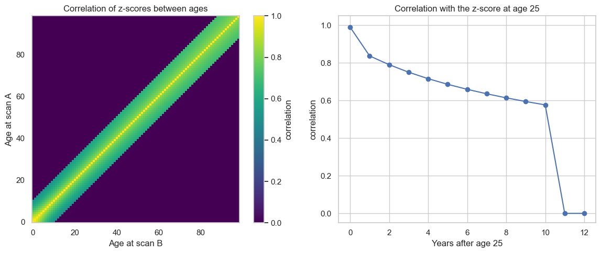
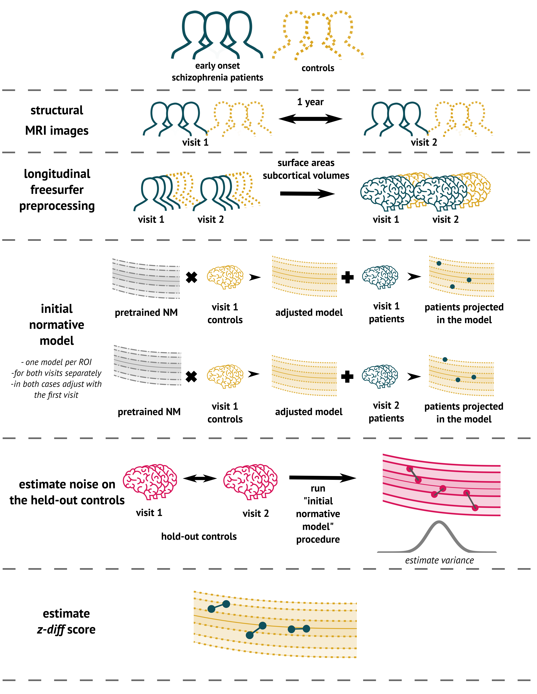
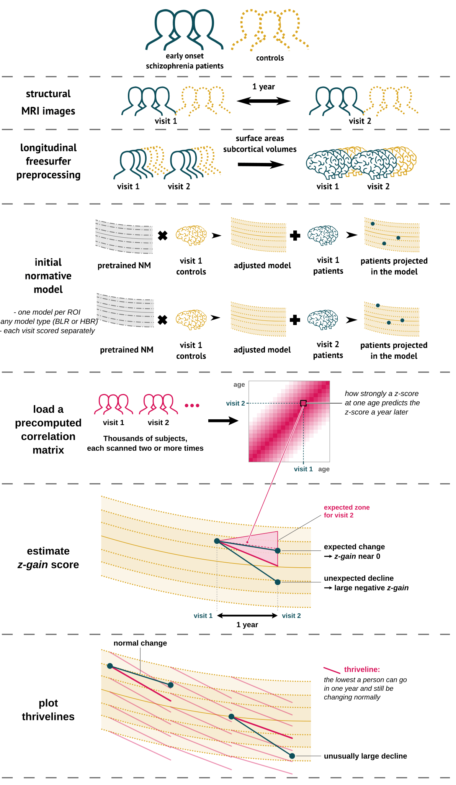
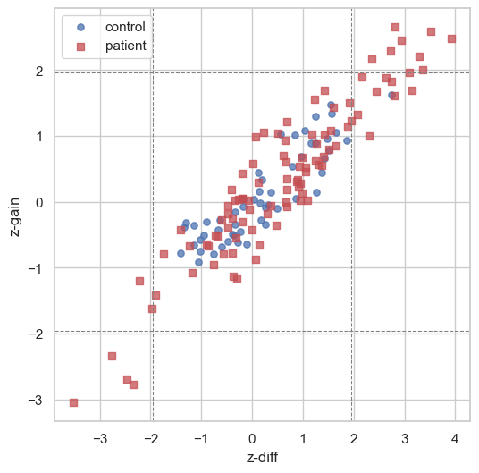
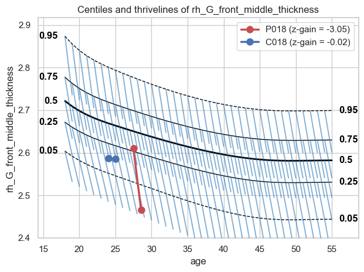

Longitudinal normative modelling
================================

.. container:: notebook-download

   :download:`Download Jupyter notebook <notebooks/14_longitudinal_modelling.ipynb>`

A normative model tells you where a single scan sits relative to a
reference population (a z-score). With two or more visits per subject,
we can ask a further question:

   Did this subject change *more than expected* between visits?

That we call **Longitudinal Normative Modelling (LNM)**.

What you need
-------------

1. **Longitudinal data**: at least two scans per person. Here: the LNM
   dataset (``LNM_data.csv``), loaded with ``load_lnm()``.
2. **A correlation matrix** (for z-gain and thrivelines): load a
   precomputed one (recommended, used here) or estimate one from your
   own longitudinal data (we have a separate tutorial for that; needs
   thousands of subjects with longitudinal data).
3. **A normative model**: fit your own, or transfer a pretrained one
   from
   `SURFdrive <https://surfdrive.surf.nl/s/Mb6mZyFmJeCaPcZ?dir=/zip>`__.

What you will learn
-------------------

- what a longitudinal dataset and a correlation matrix look like,
- how to compute **z-diff** and **z-gain**, and whether they agree,
- when to use which score,
- how to plot **thrivelines** on normative centiles.

.. code:: ipython3

    import matplotlib.pyplot as plt
    import numpy as np
    import pandas as pd
    from scipy import stats
    
    import pcntoolkit.util.output
    from pcntoolkit import ZDiffScore, ZGainScore, load_correlation_matrix, load_lnm
    from pcntoolkit.util.plotter import plot_thrivelines
    
    # Hide PCNtoolkit's "Process: ..." progress messages
    pcntoolkit.util.output.Output.set_show_messages(False)
    
    # Right middle frontal gyrus thickness: the region the example correlation
    # matrix covers.
    REGION = "rh_G_front_middle_thickness"
    CENTILES = [0.05, 0.25, 0.5, 0.75, 0.95]

1. The longitudinal data
------------------------

Our example dataset (``LNM_data.csv``) has cortical thickness for
healthy controls and patients with early-stage schizophrenia, each
scanned twice about a year apart (`Rehák Bučková et al.,
2025 <https://doi.org/10.7554/eLife.95823>`__).

.. code:: ipython3

    lnm = load_lnm()
    lnm.to_dataframe()[["subject_ids", "visits", "X", "batch_effects"]].head()

.. raw:: html

    

    
    <table border="1" class="dataframe">
      <thead>
        <tr>
          <th></th>
          <th>subject_ids</th>
          <th>visits</th>
          <th>X</th>
          <th colspan="2" halign="left">batch_effects</th>
        </tr>
        <tr>
          <th></th>
          <th>subject_ids</th>
          <th>visit</th>
          <th>age</th>
          <th>sex</th>
          <th>site</th>
        </tr>
        <tr>
          <th>observations</th>
          <th></th>
          <th></th>
          <th></th>
          <th></th>
          <th></th>
        </tr>
      </thead>
      <tbody>
        <tr>
          <th>0</th>
          <td>C000</td>
          <td>1</td>
          <td>39.377</td>
          <td>M</td>
          <td>NIMH-CZ</td>
        </tr>
        <tr>
          <th>1</th>
          <td>C001</td>
          <td>1</td>
          <td>30.666</td>
          <td>M</td>
          <td>NIMH-CZ</td>
        </tr>
        <tr>
          <th>2</th>
          <td>C002</td>
          <td>1</td>
          <td>34.160</td>
          <td>M</td>
          <td>NIMH-CZ</td>
        </tr>
        <tr>
          <th>3</th>
          <td>C003</td>
          <td>1</td>
          <td>26.474</td>
          <td>F</td>
          <td>NIMH-CZ</td>
        </tr>
        <tr>
          <th>4</th>
          <td>C004</td>
          <td>1</td>
          <td>25.764</td>
          <td>M</td>
          <td>NIMH-CZ</td>
        </tr>
      </tbody>
    </table>
    

.. code:: ipython3

    subject_ids = lnm.get_subject_ids()
    ages = lnm.X.sel(covariates="age").values
    
    print(f"Subjects:             {len(np.unique(subject_ids))}")
    print(f"Visits per subject:   {int(lnm.get_visits().max())}")
    print(f"Age range:            {ages.min():.0f} to {ages.max():.0f} years")
    print(f"Brain regions:        {lnm.sizes['response_vars']}")

.. code:: text

    Subjects:             165
    Visits per subject:   2
    Age range:            18 to 55 years
    Brain regions:        185
    

Now load controls and patients separately. We keep one region because
the example correlation matrix covers only that one.

.. code:: ipython3

    controls = load_lnm(group="control").sel(response_vars=[REGION])
    patients = load_lnm(group="patient").sel(response_vars=[REGION])

2. The correlation matrix
-------------------------

z-gain and thrivelines need an age-by-age correlation matrix: how
strongly a person’s z-score at one age is related to their z-score at
another age.

A reliable matrix needs thousands of people scanned repeatedly, so we
recommend reusing a precomputed one. The one we use in this tutorial was
estimated by `Bayer et al. (2026) <https://arxiv.org/abs/2601.07591>`__
in thousands of subjects, each scanned two or more times.

Note that the correlation matrix does not have to come from the same
data as your normative model.

.. code:: ipython3

    corr = load_correlation_matrix()
    matrix = corr.matrix.sel(response_vars=REGION)
    
    age = 25
    gaps = np.arange(0, 13)
    
    fig, axes = plt.subplots(1, 2, figsize=(12, 5), gridspec_kw={"width_ratios": [1.1, 1]})
    image = axes[0].imshow(matrix.values, origin="lower", cmap="viridis", vmin=0, vmax=1)
    axes[0].set_xlabel("Age at scan B")
    axes[0].set_ylabel("Age at scan A")
    axes[0].set_title("Correlation of z-scores between ages")
    axes[0].grid(False)
    fig.colorbar(image, ax=axes[0], label="correlation")
    
    axes[1].plot(gaps, [corr.get(REGION, age, age + gap) for gap in gaps], marker="o")
    axes[1].set_xlabel(f"Years after age {age}")
    axes[1].set_ylabel("correlation")
    axes[1].set_title(f"Correlation with the z-score at age {age}")
    axes[1].set_ylim(-0.05, 1.05)
    plt.tight_layout()
    plt.show()

We see that the correlations are strongest on the diagonal and fade as
scans get further apart in time.

Also we see that the matrix only holds correlations for scans up to 10
years apart and sets everything beyond that to 0. The two visits in our
``LNM_data.csv`` are 1–3 years apart, well within that range.

3. Fit and transfer a normative model
-------------------------------------

Longitudinal modelling starts from an ordinary normative model, so we
build one first, exactly as in the earlier tutorials. Any normative
model works. Here we fit a BLR model on fcon1000 and then transfer it to
the LNM site, which the model has never seen.

.. code:: ipython3

    from pcntoolkit import BLR, NormativeModel, load_fcon1000
    from pcntoolkit.math_functions.basis_function import BsplineBasisFunction
    
    # Fit on fcon1000
    fcon1000 = load_fcon1000().sel(response_vars=[REGION])
    fcon1000_model = NormativeModel(
        BLR(
            basis_function_mean=BsplineBasisFunction(degree=3, nknots=5),
            warp_name="warpsinharcsinh",
        ),
        inscaler="standardize",
        outscaler="standardize",
        savemodel=False,
        saveresults=False,
        saveplots=False,
    )
    fcon1000_model.fit(fcon1000);

.. code:: ipython3

    # Get the controls' subject IDs and visit numbers
    control_subjects = controls.get_subject_ids()
    control_visits = controls.get_visits()
    
    # Randomly pick 20% of the controls for the adaptation group
    all_controls = np.unique(control_subjects)
    rng = np.random.default_rng(42)
    adaptation_people = rng.choice(all_controls, size=int(0.2 * len(all_controls)), replace=False)
    
    # True for every scan of a control subject in the adaptation group
    in_adaptation_group = np.isin(control_subjects, adaptation_people)
    
    # Select adaptation controls only from visit 1 because visit 2 is highly correlated 
    # with visit 1, so it adds no new information for the adaptation
    adapt_controls = controls.isel(observations=in_adaptation_group & (control_visits == 1))
    reference_controls = controls.isel(observations=~in_adaptation_group)
    
    print(f"Adaptation group: {len(adaptation_people)} people, visit 1 only")
    print(f"Reference group:  {len(all_controls) - len(adaptation_people)} people, both visits")

.. code:: text

    Adaptation group: 13 people, visit 1 only
    Reference group:  54 people, both visits
    

.. code:: ipython3

    # Adapt/transfer the fcon1000 model to the LNM site
    lnm_model = fcon1000_model.transfer(adapt_controls);
    
    # Get a z-score for every visit of the reference controls and the patients
    lnm_model.predict(reference_controls);
    lnm_model.predict(patients);

4. z-diff vs z-gain score
-------------------------

Both scores ask whether a person’s change between visits is unusual.
Values near 0 are typical; large positive or negative values flag
unusual change.

z-diff
~~~~~~

*z-diff* (`Rehák Bučková et al.,
2025 <https://doi.org/10.7554/eLife.95823>`__) quantifies the
longitudinal change in a brain measure relative to what would be
expected based on healthy ageing, divided by how much this change
typically varies in healthy controls. It needs a BLR model and only two
visits per subject.

   Step-by-step computation of the z-diff score

**Fig. 1:** *How z-diff is computed. Kudos to Barbora Rehák Bučková for
making this fugure (*\ `Rehák Bučková et al.,
2025 <https://doi.org/10.7554/eLife.95823>`__\ *).*

z-gain
~~~~~~

*z-gain* (`Bayer et al., 2026 <https://arxiv.org/abs/2601.07591>`__)
asks whether the later z-score is surprising given the earlier one based
on the knowledge coming from the correlation matrix. It works with any
model and any number of visits.

   Step-by-step computation of the z-gain score and thrivelines

**Fig. 2:** *How z-gain and thrivelines are computed. The first rows are
the same as for z-diff because both methods require estimation of the
cross-sectional models, so the pre-processing and model estimation is
identical.*

Which score should I use?
~~~~~~~~~~~~~~~~~~~~~~~~~

=================================== ================================
You have…                           Use
=================================== ================================
Two visits, BLR or warped-BLR model ``ZDiffScore`` or ``ZGainScore``
Want thrivelines                    ``ZGainScore``
Three or more visits                ``ZGainScore``
HBR model                           ``ZGainScore``
=================================== ================================

Computing the scores
~~~~~~~~~~~~~~~~~~~~

Both scores work in two steps:

1. **Create the score object** with what stays the same for everyone:
   the normative model, plus the reference to compare against (z-diff:
   the held-out controls; z-gain: the correlation matrix). Nothing is
   computed yet.
2. **Call ``.score(data)``** on the people you want to score.

The z-gain object has a second method, ``.get_thrivelines()``, which
reuses the same model and correlation matrix to draw thrivelines
(section 6).

.. code:: ipython3

    # Create the ZDiffScore object
    zdiff = ZDiffScore(lnm_model, reference_data=reference_controls)
    
    # Compute zdiff
    zdiff_patients = zdiff.score(patients)
    # Display the first few z-diff scores for the specified region
    zdiff_patients.sel(response_vars=REGION).to_series().head()

.. code:: text

    subjects
    P000   -0.479059
    P001   -2.467373
    P002   -0.186780
    P003    0.990796
    P004   -0.404522
    Name: zdiff, dtype: float64

.. code:: ipython3

    # Create the ZGainScore object
    zgain = ZGainScore(lnm_model, corr)
    
    # Compute zgain
    zgain_patients = zgain.score(patients)
    # Display the first few z-gain scores for the specified region
    zgain_patients.sel(response_vars=REGION).to_series().head()

.. code:: text

    subjects
    P000   -0.060133
    P001   -2.685842
    P002   -0.296639
    P003    0.673875
    P004    0.183253
    Name: zgain, dtype: float64

To compare the two scores, we also score the held-out controls and put
everything in one table.

.. code:: ipython3

    control_scores = pd.DataFrame(
        {
            "z_diff": zdiff.score(reference_controls).sel(response_vars=REGION).to_series(),
            "z_gain": zgain.score(reference_controls).sel(response_vars=REGION).to_series(),
            "group": "control",
        }
    )
    patient_scores = pd.DataFrame(
        {
            "z_diff": zdiff_patients.sel(response_vars=REGION).to_series(),
            "z_gain": zgain_patients.sel(response_vars=REGION).to_series(),
            "group": "patient",
        }
    )
    scores = pd.concat([control_scores, patient_scores])
    scores.head()

.. raw:: html

    

    
    <table border="1" class="dataframe">
      <thead>
        <tr style="text-align: right;">
          <th></th>
          <th>z_diff</th>
          <th>z_gain</th>
          <th>group</th>
        </tr>
        <tr>
          <th>subjects</th>
          <th></th>
          <th></th>
          <th></th>
        </tr>
      </thead>
      <tbody>
        <tr>
          <th>C000</th>
          <td>0.965918</td>
          <td>0.685298</td>
          <td>control</td>
        </tr>
        <tr>
          <th>C001</th>
          <td>-1.025966</td>
          <td>-0.749019</td>
          <td>control</td>
        </tr>
        <tr>
          <th>C002</th>
          <td>1.261810</td>
          <td>0.143184</td>
          <td>control</td>
        </tr>
        <tr>
          <th>C003</th>
          <td>-1.307466</td>
          <td>-0.318350</td>
          <td>control</td>
        </tr>
        <tr>
          <th>C007</th>
          <td>0.869395</td>
          <td>0.045803</td>
          <td>control</td>
        </tr>
      </tbody>
    </table>
    

Do z-diff and z-gain agree?
~~~~~~~~~~~~~~~~~~~~~~~~~~~

Does a person with an extreme z-diff also have an extreme z-gain? Here
we call a score *extreme* when it is beyond ±1.96 (dashed lines).

.. code:: ipython3

    fig, ax = plt.subplots(figsize=(6, 6))
    for group_name, color, marker in [("control", "#4c72b0", "o"), ("patient", "#c44e52", "s")]:
        group_scores = scores[scores["group"] == group_name]
        ax.scatter(group_scores["z_diff"], group_scores["z_gain"], s=28, alpha=0.75,
                   color=color, marker=marker, label=group_name)
    for threshold in [-1.96, 1.96]:
        ax.axvline(threshold, color="grey", ls="--", lw=0.8)
        ax.axhline(threshold, color="grey", ls="--", lw=0.8)
    ax.set_xlabel("z-diff")
    ax.set_ylabel("z-gain")
    ax.legend()
    plt.show()
    
    rho, _ = stats.spearmanr(scores["z_diff"], scores["z_gain"])
    print(f"Spearman correlation: {rho:.2f}")
    
    # Count, per group, how many people each score calls extreme (beyond ±1.96)
    extreme_z_diff = scores["z_diff"].abs() > 1.96
    extreme_z_gain = scores["z_gain"].abs() > 1.96
    pd.DataFrame(
        {
            "extreme on both": (extreme_z_diff & extreme_z_gain).groupby(scores["group"]).sum(),
            "extreme on z-diff only": (extreme_z_diff & ~extreme_z_gain).groupby(scores["group"]).sum(),
            "extreme on z-gain only": (~extreme_z_diff & extreme_z_gain).groupby(scores["group"]).sum(),
        }
    )

.. code:: text

    Spearman correlation: 0.90
    

.. raw:: html

    

    
    <table border="1" class="dataframe">
      <thead>
        <tr style="text-align: right;">
          <th></th>
          <th>extreme on both</th>
          <th>extreme on z-diff only</th>
          <th>extreme on z-gain only</th>
        </tr>
        <tr>
          <th>group</th>
          <th></th>
          <th></th>
          <th></th>
        </tr>
      </thead>
      <tbody>
        <tr>
          <th>control</th>
          <td>0</td>
          <td>1</td>
          <td>0</td>
        </tr>
        <tr>
          <th>patient</th>
          <td>13</td>
          <td>10</td>
          <td>0</td>
        </tr>
      </tbody>
    </table>
    

The two scores rank people almost the same way (Spearman correlation:
0.90), and every patient with an extreme z-gain also has an extreme
z-diff. z-diff though flags as extreme a few more patients than z-gain.

5. Thrivelines
--------------

Thrivelines borrow an idea from children’s growth charts. Each short
blue line starts on a centile and runs one year forward. It shows the
lowest a person starting there can go while still changing within the
normal range:

- **staying on or above a thriveline**: normal change,
- **dropping below it**: unusually large decline (z-gain below −1.96).

Below we draw the patient with the most negative z-gain (red) and the
control with the most typical change (blue).

``ZGainScore.get_thrivelines()`` computes the thrivelines from the
correlation matrix, and ``plot_thrivelines()`` draws them on the
normative model’s centile chart.

.. code:: ipython3

    # Get the age range of LNM_data.csv
    lnm_ages = lnm.X.sel(covariates="age").values
    youngest, oldest = int(lnm_ages.min()), int(lnm_ages.max()) + 1
    
    # Compute thrivelines
    thrivelines = zgain.get_thrivelines(
        centiles=CENTILES, # the centiles at which thrivelines start
        covariate_range=(youngest, oldest),
    )
    
    # Select 2 subjects
    declining_patient = scores.loc[scores["group"] == "patient", "z_gain"].idxmin()
    typical_control = scores.loc[scores["group"] == "control", "z_gain"].abs().idxmin()
    
    # Plot thrivelines
    figs = plot_thrivelines(
        lnm_model,
        thrivelines=thrivelines,
        centiles=CENTILES,
        response_vars=[REGION],
        show_figure=False,
    )
    # Plot the individual trajectories of the selected subjects over the thrivelines
    ax = figs[0].axes[0]
    for person, data, color in [
        (declining_patient, patients, "#c44e52"),
        (typical_control, reference_controls, "#4c72b0"),
    ]:
        is_person = data.get_subject_ids() == person
        ax.plot(
            data.X.sel(covariates="age").values[is_person],
            data.Y.sel(response_vars=REGION).values[is_person],
            color=color, lw=2.5, marker="o", markersize=8, zorder=10,
            label=f"{person} (z-gain = {scores.loc[person, 'z_gain']:.2f})",
        )
    ax.legend(loc="best")
    plt.show()

