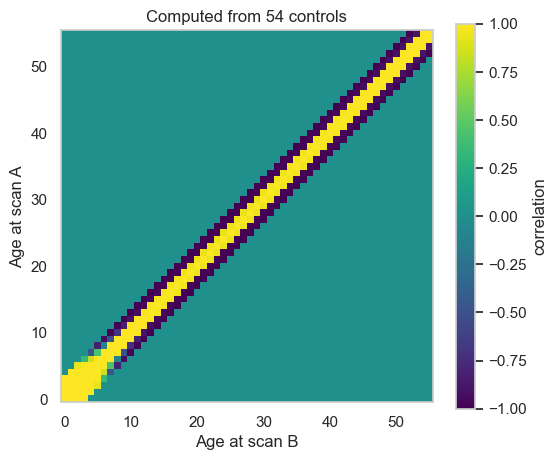
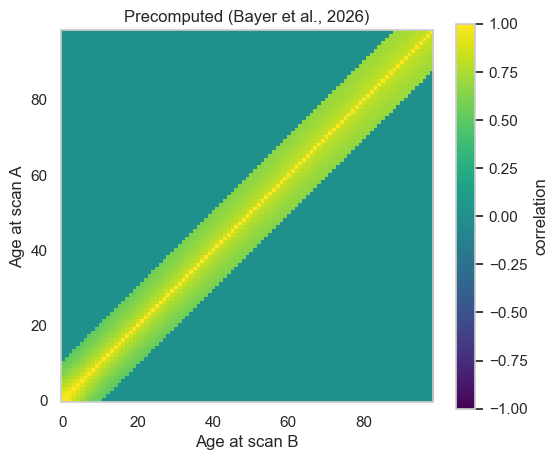

Computing your own correlation matrix
=====================================

.. container:: notebook-download

   :download:`Download Jupyter notebook <notebooks/16_correlation_matrix.ipynb>`

Velocity models (z-gain and thrivelines) need an age-to-age
**correlation matrix** (how z-scores correlate between ages). In
PCNtoolkit you can either load a precomputed correlation matrix
(``CorrelationMatrix.load()``) or compute your own from the z-scores of
your longitudinal data (``CorrelationMatrix.compute()``). In this
tutorial we will compute one.

Our example dataset (``LNM_data.csv``) has cortical thickness for
healthy controls and patients with early-stage schizophrenia, each
scanned twice 1–3 years apart (`Rehák Bučková et al.,
2025 <https://doi.org/10.7554/eLife.95823>`__).

A reliable matrix needs thousands of people scanned repeatedly. We only
have a small number of subjects in our dataset, so we will see that most
of the matrix is “guessed” rather than measured.

.. code:: ipython3

    import matplotlib.pyplot as plt
    import numpy as np
    
    import pcntoolkit.util.output
    from pcntoolkit import (
        BLR,
        CorrelationMatrix,
        NormativeModel,
        fetch_example_correlation_matrix,
        load_fcon1000,
        load_lnm,
    )
    from pcntoolkit.math_functions.basis_function import BsplineBasisFunction
    
    # Hide PCNtoolkit's "Process: ..." progress messages
    pcntoolkit.util.output.Output.set_show_messages(False)
    
    REGION = "rh_G_front_middle_thickness"

1. The longitudinal data
------------------------

We estimate the correlation matrix from the healthy controls only. We
don’t include the patients as we want the correlation matrix to describe
how z-scores *normally* change over time.

.. code:: ipython3

    controls = load_lnm(group="control").sel(response_vars=[REGION])
    patients = load_lnm(group="patient").sel(response_vars=[REGION])
    
    print(f"Controls:  {len(np.unique(controls.get_subject_ids()))}")
    print(f"Patients:  {len(np.unique(patients.get_subject_ids()))}")

.. code:: text

    Controls:  67
    Patients:  98
    

2. Fit and transfer a normative model
-------------------------------------

The correlation matrix is computed from z-scores, so we first need the
controls’ z-scores. We fit a BLR model on fcon1000, transfer it to the
LNM site.

.. code:: ipython3

    fcon1000 = load_fcon1000().sel(response_vars=[REGION])
    fcon1000_model = NormativeModel(
        BLR(
            basis_function_mean=BsplineBasisFunction(degree=3, nknots=5),
            warp_name="warpsinharcsinh",
        ),
        inscaler="standardize",
        outscaler="standardize",
        savemodel=False,
        saveresults=False,
        saveplots=False,
    )
    fcon1000_model.fit(fcon1000);

.. code:: ipython3

    # Randomly pick 20% of the controls for the adaptation group
    control_subjects = controls.get_subject_ids()
    all_controls = np.unique(control_subjects)
    rng = np.random.default_rng(42)
    adaptation_people = rng.choice(
        all_controls, size=int(0.2 * len(all_controls)), replace=False
    )
    in_adaptation_group = np.isin(control_subjects, adaptation_people)
    
    # Adapt on visit 1 only; keep both visits of the others for the matrix
    adapt_controls = controls.isel(
        observations=in_adaptation_group & (controls.get_visits() == 1)
    )
    reference_controls = controls.isel(observations=~in_adaptation_group)
    
    n_reference = len(all_controls) - len(adaptation_people)
    print(f"Adaptation group: {len(adaptation_people)} people, visit 1 only")
    print(f"Reference group:  {n_reference} people, both visits")

.. code:: text

    Adaptation group: 13 people, visit 1 only
    Reference group:  54 people, both visits
    

.. code:: ipython3

    # Adapt/transfer the fcon1000 model to the LNM site
    lnm_model = fcon1000_model.transfer(adapt_controls)
    
    # Get a z-score for the rest of the controls
    lnm_model.predict(reference_controls);

3. Compute the correlation matrix
---------------------------------

``bandwidth`` is the widest age gap, in years, that gets a correlation;
wider gaps are set to 0. Our visits are at most 3 years apart, so we use
bandwidth=3.

.. code:: ipython3

    corr = CorrelationMatrix.compute(reference_controls, bandwidth=3)
    
    print(f"Subjects:       {corr.n_subjects}")
    print(f"Observed ages:  {corr.estimated_range[0]} to {corr.estimated_range[1]}")

.. code:: text

    Subjects:       54
    Observed ages:  18 to 55
    

4. Most of the matrix is extrapolated
-------------------------------------

An age pair gets a correlation from the data only if at least 4 people
were scanned at both ages. All other pairs are predicted by a regression
(extrapolated or intrapolated).

We have very few controls, so most of our correlation matrix is
extrapolated.

.. code:: ipython3

    fig, ax = plt.subplots(figsize=(6, 5))
    image = ax.imshow(
        corr.matrix.sel(response_vars=REGION).values,
        origin="lower",
        cmap="viridis",
        vmin=-1,
        vmax=1,
    )
    fig.colorbar(image, ax=ax, label="correlation")
    ax.set_xlabel("Age at scan B")
    ax.set_ylabel("Age at scan A")
    ax.set_title(f"Computed from {corr.n_subjects} controls")
    ax.grid(False)
    plt.show()

The diagonal is 1 by definition. The yellow band (1-year gaps, r ≈ 0.95)
is the only gap with data, from some age pairs. The 2- and 3-years gaps
are extrapolated and come out near −1. Ages below 18, where we have no
data, are also extrapolated (bottom-left).

That is why we recommend using a precomputed correlation matrix. Below
is one from (`Bayer et
al. (2026) <https://arxiv.org/abs/2601.07591>`__), estimated from
thousands of subjects.

We expect a well estimated correlation matrix to show the highest
correlations along the diagonal and correlations decreasing smoothly as
the time between scans increases.

.. code:: ipython3

    # Download the precomputed correlation matrix and load it
    precomputed = CorrelationMatrix.load(fetch_example_correlation_matrix())
    
    fig, ax = plt.subplots(figsize=(6, 5))
    image = ax.imshow(
        precomputed.matrix.sel(response_vars=REGION).values,
        origin="lower",
        cmap="viridis",
        vmin=-1,
        vmax=1,
    )
    fig.colorbar(image, ax=ax, label="correlation")
    ax.set_xlabel("Age at scan B")
    ax.set_ylabel("Age at scan A")
    ax.set_title("Precomputed (Bayer et al., 2026)")
    ax.grid(False)
    plt.show()

5. Save and load correlation matrix
-----------------------------------

``save()`` writes one CSV per region to a folder; ``load()`` reads it
back.

.. code:: ipython3

    corr.save("pcntoolkit_resources/data/my_correlation_matrix")
    corr = CorrelationMatrix.load("pcntoolkit_resources/data/my_correlation_matrix")
